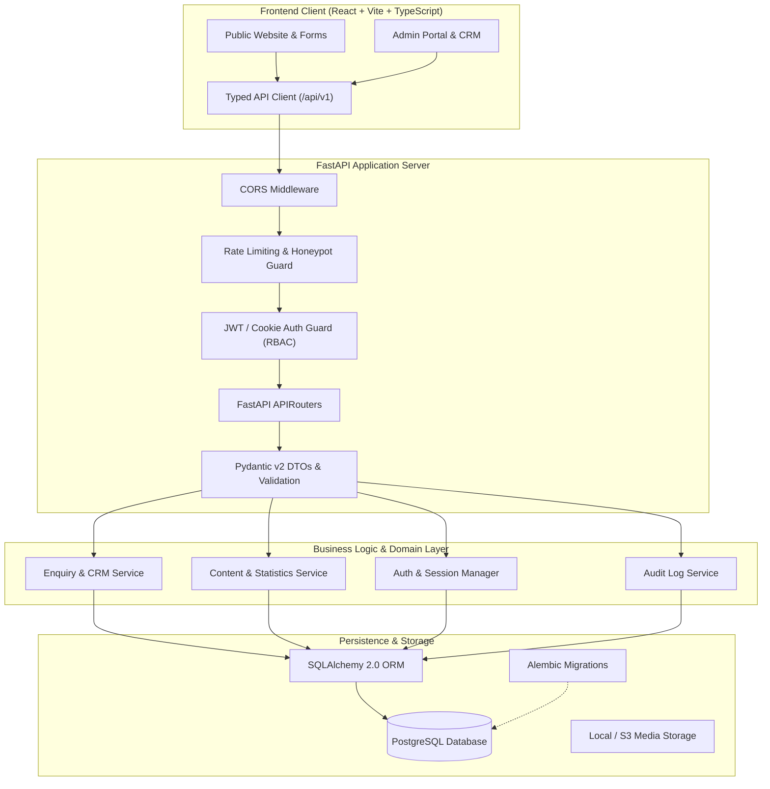

# Lotus Capital — Backend Architecture Specification: FastAPI + PostgreSQL

**Version:** 2.0 (Approved Architecture)  
**Date:** October 2026  
**Status:** Approved by Stakeholder — **FastAPI with PostgreSQL**  
**Core Technologies:**  
- **Backend:** FastAPI (Python 3.11+ / 3.13), Uvicorn ASGI Server  
- **Database & ORM:** PostgreSQL, SQLAlchemy 2.0 (async/sync), Alembic Migrations  
- **Validation & Serialization:** Pydantic v2 schemas matching `Api_end_points.md`  
- **Authentication & Security:** HTTP-Only Secure Cookies / JWT Bearer tokens, Passlib/Bcrypt password hashing, Role-Based Access Control (`admin`, `staff`)  
- **Frontend Integration:** React + TypeScript + Vite, Axios/Fetch typed client with base path `/api/v1`

---

## 1. Architectural Decision Record (ADR)

### Context & User Direction
The architecture evaluation considered both a BaaS approach (Supabase) and a custom micro-framework approach (FastAPI + PostgreSQL). The user explicitly confirmed:
> **"Use FastAPI with Postgres, not Supabase."**

### Rationale & Strategic Advantages for Lotus Capital:
1. **Full Protocol & Business Logic Sovereignty:** Complete control over endpoint execution, custom middleware, data validation pipelines, and audit trails without vendor lock-in to proprietary cloud platforms.
2. **Alignment with API Specifications:** Direct 1-to-1 fidelity with `Api_end_points.md` (prefix `/api/v1`, Pydantic request/response schemas, structured error envelopes, and automated OpenAPI/Swagger documentation).
3. **Financial Regulatory Compliance & Data Residency:** Allows self-hosting or deploying PostgreSQL within Indian sovereign data centers (e.g. AWS ap-south-1 Mumbai, GCP Delhi/Mumbai) meeting SEBI and Indian DPDP (Digital Personal Data Protection) standards.
4. **Custom Integrations & Extensibility:** Seamlessly accommodates future backend pipelines (e.g., automated Indian SMS gateway gateways via DLT-registered templates, WhatsApp Cloud API webhooks, automated PDF portfolio summaries, and Religare Broking data synchronization).

---

## 2. System Architecture & Component Design



---

## 3. Database Schema Design (PostgreSQL)

### 3.1 `enquiries` Table
Stores all client consultation requests captured across public forms.
```sql
CREATE TABLE enquiries (
    id UUID PRIMARY KEY DEFAULT gen_random_uuid(),
    reference_id VARCHAR(20) UNIQUE NOT NULL, -- e.g. LC-20261028-XXXX
    full_name VARCHAR(100) NOT NULL,
    mobile VARCHAR(15) NOT NULL,
    email VARCHAR(255),
    service VARCHAR(50) NOT NULL,
    message TEXT,
    contact_method VARCHAR(20) NOT NULL DEFAULT 'phone', -- phone, whatsapp, email
    consent_given BOOLEAN NOT NULL DEFAULT true,
    source_path VARCHAR(255) NOT NULL,
    utm_source VARCHAR(100),
    utm_medium VARCHAR(100),
    utm_campaign VARCHAR(100),
    status VARCHAR(30) NOT NULL DEFAULT 'new', -- new, contacted, qualified, in_progress, converted, closed
    assigned_to UUID REFERENCES users(id),
    follow_up_date TIMESTAMP WITH TIME ZONE,
    notes TEXT,
    ip_hash VARCHAR(64), -- anonymized SHA-256 for abuse detection
    created_at TIMESTAMP WITH TIME ZONE DEFAULT CURRENT_TIMESTAMP,
    updated_at TIMESTAMP WITH TIME ZONE DEFAULT CURRENT_TIMESTAMP
);

CREATE INDEX idx_enquiries_status ON enquiries(status);
CREATE INDEX idx_enquiries_service ON enquiries(service);
CREATE INDEX idx_enquiries_created_at ON enquiries(created_at DESC);
```

### 3.2 `users` Table
Stores internal staff and administrators.
```sql
CREATE TABLE users (
    id UUID PRIMARY KEY DEFAULT gen_random_uuid(),
    email VARCHAR(255) UNIQUE NOT NULL,
    hashed_password VARCHAR(255) NOT NULL,
    full_name VARCHAR(100) NOT NULL,
    role VARCHAR(20) NOT NULL DEFAULT 'staff', -- 'admin' or 'staff'
    is_active BOOLEAN NOT NULL DEFAULT true,
    last_login_at TIMESTAMP WITH TIME ZONE,
    created_at TIMESTAMP WITH TIME ZONE DEFAULT CURRENT_TIMESTAMP
);
```

### 3.3 `statistics` Table
Stores all metrics from `00-client-data-register.md` to enforce governance.
```sql
CREATE TABLE statistics (
    id VARCHAR(50) PRIMARY KEY, -- e.g. 'clients_serviced', 'mf_folios'
    label VARCHAR(100) NOT NULL,
    value VARCHAR(50) NOT NULL,
    display_text VARCHAR(100) NOT NULL,
    unit VARCHAR(20),
    tier VARCHAR(5) NOT NULL, -- 'A', 'B', 'C'
    as_of_date DATE,
    definition_note TEXT,
    source_document VARCHAR(100) NOT NULL,
    approval_status VARCHAR(20) NOT NULL DEFAULT 'pending', -- 'pending', 'approved', 'withheld'
    approved_by UUID REFERENCES users(id),
    approved_at TIMESTAMP WITH TIME ZONE,
    pages JSONB NOT NULL DEFAULT '[]'::jsonb
);
```

### 3.4 `audit_logs` Table
Maintains compliance trail for all administrative mutations.
```sql
CREATE TABLE audit_logs (
    id UUID PRIMARY KEY DEFAULT gen_random_uuid(),
    user_id UUID REFERENCES users(id),
    action VARCHAR(50) NOT NULL, -- e.g. 'LEAD_STATUS_UPDATE', 'STAT_APPROVAL'
    entity VARCHAR(50) NOT NULL, -- 'enquiries', 'statistics'
    entity_id VARCHAR(50) NOT NULL,
    old_values JSONB,
    new_values JSONB,
    ip_address VARCHAR(45),
    created_at TIMESTAMP WITH TIME ZONE DEFAULT CURRENT_TIMESTAMP
);
```

---

## 4. API Endpoints Implementation Plan (FastAPI)

All endpoints conform strictly to `Api_end_points.md` with URL prefix `/api/v1`:

### 4.1 Public Endpoints
- `GET /api/v1/health`: Liveness and database connectivity check.
- `POST /api/v1/enquiries`: Validates input with Pydantic, checks honeypot, generates human-readable `reference_id` (e.g. `LC-202610-8831`), persists to PostgreSQL, and returns HTTP 201.
- `GET /api/v1/content/statistics`: Returns **only** statistics where `approval_status = 'approved'` AND `as_of_date IS NOT NULL`. Tier C metrics are filtered out.
- `GET /api/v1/content/registrations`: Serves verified AMFI, Religare AP, and IRDAI registration strings.
- `GET /api/v1/content/disclaimers`: Returns official disclosure and risk notes.

### 4.2 Administrative & CRM Endpoints (Secured via OAuth2 Bearer / Cookie)
- `POST /api/v1/auth/login`: Verifies credentials, returns session JWT.
- `GET /api/v1/auth/me`: Returns current user identity and role.
- `GET /api/v1/admin/leads`: Filterable by status, service, and date range with pagination.
- `PATCH /api/v1/admin/leads/{id}`: Updates lead status (`new` → `contacted` → `converted`), notes, and follow-up dates. Logs action in `audit_logs`.
- `GET /api/v1/admin/reports/enquiries`: Returns aggregated monthly enquiry metrics grouped by service.
- `PATCH /api/v1/admin/statistics/{id}`: Allows authorized admin to update `as_of_date` and toggle approval status.

---

## 5. Security & Financial Compliance Safeguards

1. **Anti-Abuse & Rate Limiting:**
   - In-memory or Redis-backed rate limiter on `POST /api/v1/enquiries`: Maximum 10 requests per minute per IP address.
   - Invisible honeypot field (`website` / `b_field`): submissions containing data in this field are dropped silently without storage.
2. **Zero PII Exposure:**
   - Public content endpoints never return user or lead information.
   - Standardized non-revealing error responses (`{"error": {"code": "VALIDATION_ERROR", "message": "The request could not be processed."}}`).
3. **Database Security:**
   - Use parameterized queries exclusively via SQLAlchemy ORM (prevents SQL injection).
   - Database credentials managed strictly through environment variables (`DATABASE_URL`), never committed to git.
4. **CORS Policy:**
   - Explicit whitelist allowing only the verified frontend origin (e.g., `http://localhost:5173` for development, production domain for release).
