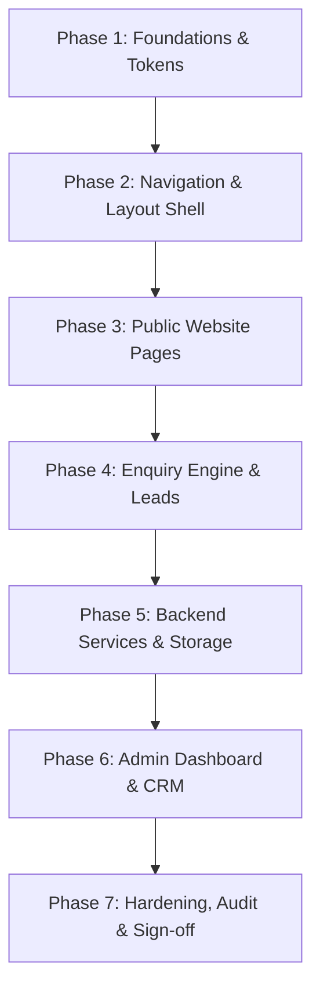

# Lotus Capital — Implementation Plan & Delivery Roadmap

**Version:** 1.0  
**Target Completion:** Production Release  
**Philosophy:** Rigorous testing, single source of truth, zero unverified financial claims, institutional UI quality.  
**Companion Documents:** `REFERENCE_ANALYSIS.md`, `DESIGN_SYSTEM.md`, `ARCHITECTURE_RECOMMENDATION.md`, `GAP_ANALYSIS.md`

---

## 1. Project Overview & Guiding Constraints

The primary objective is to implement the digital presence for **Lotus Capital — Partnering Wealth Creation** (Godhra, Gujarat), adhering strictly to the official 10-page Design Reference Guide, site structure specifications, and financial regulatory requirements.

### Non-Negotiable Operational Constraints:
1. **Single Source of Truth:** All numerical figures, licences, partner details, and disclaimers reside strictly within `content/data/*.json`. No hardcoded financial metrics in frontend components or backend logic.
2. **Strict Stat Visibility Rules:** A statistic appears publicly if and only if `approvalStatus === 'approved'` **and** `asOfDate` is present. Tier C performance figures (e.g. 23% CAGR) are permanently withheld until full compliance sign-off.
3. **Regulatory Protection:** The global mutual fund disclaimer must appear in the footer of every public route. Every insurance page must carry the solicitation note. Equity services must accurately reflect Authorised Person status under Religare Broking Limited.
4. **Zero Data Inventing:** Placeholders are explicitly used for unconfirmed client assets (photos, testimonials, registration dates).

---

## 2. Prioritized Implementation Phases

---

### Phase 1: Environment & Token Foundation
- **Objectives:** Establish design tokens, typography, asset pipeline, and typed data structures.
- **Tasks:**
  - Standardize master CSS variables and Tailwind tokens per `DESIGN_SYSTEM.md`.
  - Configure Poppins and Inter webfonts with `font-display: swap` and tabular numbers.
  - Set up SVG assets (`lotus_capital_logo_traced.svg`) in light reversed, dark full-color, and standalone mark variants.
  - Validate and freeze TypeScript definitions in `content/data/types.ts`.
  - Validate all JSON files (`statistics.json`, `registrations.json`, `disclaimers.json`, `services.json`, `seo.json`).
- **Dependencies:** Workspace fonts and vector assets.
- **Acceptance Criteria:**
  - Design tokens compile without warnings.
  - Data files conform 100% to TypeScript schemas.
  - Vitest verification of data structures passes.

---

### Phase 2: Navigation & Structural Shell
- **Objectives:** Implement the adaptive header over photography, mobile menu, and global footer.
- **Tasks:**
  - Build `<Header />` supporting State A (transparent over hero with scrim), State B (scrolled blur at `scrollY > 24px`), State C (solid on secondary pages), and State D (mobile drawer).
  - Implement Services Dropdown with keyboard navigation and focus trapping.
  - Build `<Breadcrumbs />` component with schema.org structured data.
  - Build `<Footer />` featuring the required 12-column layout, light logo, contact details, partner links, registration summary, and the mandatory `footer_disclaimer`.
  - Build `<PublicLayout />` wrapping all public views with React Helmet Async for SEO meta tags.
- **Dependencies:** Phase 1 tokens and SVG assets.
- **Acceptance Criteria:**
  - Header transitions smoothly from transparent to blurred navy at 24px scroll.
  - Footer disclaimer is verified present on every public route.
  - Skip-to-content accessibility link functions for keyboard users.

---

### Phase 3: Public Pages & Financial Component Implementation
- **Objectives:** Implement all 18 routes specified in `Structure.md` with layout fidelity to the Design Reference PDF.
- **Tasks:**
  - **Home (`/`):**
    - Reference 1 Hero: eyebrow, 3-line headline, dual CTAs, overlapping stat block.
    - Reference 5 About Preview: split layout with founder portrait and 4 value tiles.
    - Reference 2 Services Grid: 6 cards with icon transitions, microcopy, and stat chips.
    - Reference 3 Trust & Customer Count: dynamic counter (`2,500+ clients`), 4 stat columns, floating testimonial cards, and dark CTA band.
    - Reference 5 Partner Logo Strip: greyscale-to-color hover and marquee animation.
    - How We Work 4-step row and FAQ accordion.
  - **About Us (`/about-us`):**
    - Leadership profiles (Abhilash Chudasama with `Owner.png` and Kajal Chudasama).
    - Verified milestones timeline and awards gallery.
    - Official registrations table with exact regulatory wording.
  - **Services Overview (`/services`):**
    - Full service cards taxonomy with direct routing.
  - **Insurance Pages (`/services/general-insurance`, `/services/life-insurance`, `/services/health-insurance`):**
    - Reference 4 ETMoney model: Hero with quote CTA, Overview, Categories grid, "What to compare" checklist, Insurer partners, 4-step quote guide, FAQs, and statutory solicitation note.
  - **Mutual Funds (`/investments/mutual-funds`):**
    - Hero with AMFI distributor disclosure strip.
    - Illustration board with interactive SIP calculator (`#sip-calculator`), sliders, and live chart.
    - Mandatory mutual fund disclaimer note.
  - **Equity & Investments (`/investments/equity`):**
    - Authorised Person disclosure under Religare Broking Limited (NSE/BSE codes).
    - Market risk notice and demat account stat badge.
  - **More Solutions (`/investments/other-solutions`):**
    - FDs, Bonds, NPS, loans; Real estate block hidden behind `SHOW_REAL_ESTATE` feature flag.
  - **Insights & Detail (`/insights`, `/insights/:slug`):**
    - Educational article listing and readable 720px single-column template.
  - **Utility & Legal Pages:**
    - Contact Us (`/contact-us`), Thank You (`/enquiry/thank-you`), Privacy Policy (`/privacy-policy`), Terms (`/terms-and-conditions`), Disclosures (`/disclosures`), Complaints (`/complaints`), 404 (`*`).
- **Dependencies:** Phase 2 layout shell.
- **Acceptance Criteria:**
  - All routes render without errors.
  - Dev-only route `/dev/data-register` allows reviewing all statistics and discrepancy logs.
  - Unit tests confirm Tier C metrics never leak into rendered DOM.

---

### Phase 4: Enquiry Capture & Validation Engine
- **Objectives:** Implement secure, accessible lead capture forms across all pages.
- **Tasks:**
  - Implement shared `<EnquiryForm />` utilizing `react-hook-form` and `zod`.
  - Validate 10-digit Indian mobile numbers (`^[6-9]\d{9}$`) and sanitized name/email fields.
  - Integrate service auto-selection from URL parameter (`?service=...`).
  - Capture source route path and UTM attribution parameters (`utm_source`, `utm_medium`, `utm_campaign`).
  - Add invisible honeypot field and client-side submission rate limiting.
  - Redirect on HTTP 201 to `/enquiry/thank-you?ref=<enquiry_id>`.
  - Zero collection of sensitive personal financial identifiers (no PAN, Aadhaar, bank credentials).
- **Dependencies:** Phase 3 page integration.
- **Acceptance Criteria:**
  - Form displays clear inline validation errors conforming to WCAG contrast standards.
  - Successful submissions trigger reference ID generation and navigation.

---

### Phase 5: Backend Services & Data Persistence
- **Objectives:** Deliver production-ready API services, data storage, and security controls.
- **Tasks:**
  - Build FastAPI endpoints matching `Api_end_points.md` with Pydantic v2 schemas:
    - `GET /api/v1/health`
    - `POST /api/v1/enquiries` (validation, rate-limiting, persistence, reference ID generation)
    - `GET /api/v1/content/*` (serving sanitized, published JSON data)
    - `GET /api/v1/admin/*` (authenticated lead retrieval, metrics, and content management)
  - Configure database layer (SQLite for local sandbox testing, PostgreSQL schema definitions for deployment).
  - Implement server-side input sanitization and IP-based rate limiting (10 requests per minute per IP for enquiries).
  - Configure CORS middleware allowing requests from authorized frontend origins.
- **Dependencies:** Backend virtual environment and SQLAlchemy / Pydantic dependencies.
- **Acceptance Criteria:**
  - Automated Pytest suite achieves 100% pass rate for enquiry validation, rate limiting, and statistics filtering.
  - Non-approved statistics are filtered out of public API responses.

---

### Phase 6: Admin Dashboard & CRM Module
- **Objectives:** Implement the internal administrative portal adhering to Reference 7.
- **Tasks:**
  - Implement `<AdminLayout />` with collapsible navy sidebar (248px / 72px) and sticky top bar.
  - Build Dashboard overview matching Reference 7:
    - 4 Key KPI cards (New enquiries, Follow-ups due, Converted leads, Pending reviews).
    - Lead volume line chart and service distribution bars.
    - Overdue follow-up alert card.
  - Build Leads Management screen with status pipeline stepper (New → Contacted → Qualified → In Progress → Converted/Closed), search, and date filters.
  - Build Content Approval console to toggle statistic approval statuses and update `as_of_date`.
  - Integrate role guards (`RequireAuth`, `RequireRole`) protecting `/admin/*` routes.
- **Dependencies:** Phase 5 admin API endpoints.
- **Acceptance Criteria:**
  - Mock and live auth contexts enforce permission boundaries.
  - Lead statuses update smoothly with activity timestamping.

---

### Phase 7: Verification, Hardening & Pre-Launch Audit
- **Objectives:** Verify performance, accessibility, compliance, and cross-browser resilience.
- **Tasks:**
  - Execute full test suites: Vitest (frontend) and Pytest (backend).
  - Run ESLint, Prettier, and TypeScript compiler in strict mode.
  - Perform WCAG 2.1 AAA/AA accessibility audit across all public templates.
  - Verify responsive behavior across mobile (375px), tablet (768px), and desktop (1280px+).
  - Audit against `19-content-approval-checklist.md` to ensure zero unapproved claims are live.
- **Dependencies:** All preceding phases.
- **Acceptance Criteria:**
  - 0 TypeScript errors, 0 ESLint warnings.
  - 100% unit and integration test success.
  - Lighthouse performance score ≥ 90, accessibility score ≥ 95.

---

## 3. Risk Management & Mitigation Strategies

| Identified Risk | Impact | Probability | Mitigation Strategy |
|---|---|---|---|
| Unverified statistics published accidentally | High | Low | Automated filter at both data-layer hook (`useStatistics`) and backend API level. Statistics require explicit boolean approval and valid date string. |
| Compliance challenge on Mutual Fund returns | Critical | Low | 23% CAGR figure strictly withheld from repository codebase. Disclaimers permanently rendered in global footer and mutual funds section. |
| Incomplete client photography degrades visual polish | Medium | High | Reusable geometric vector lotus watermark and high-contrast typographic layouts provide institutional elegance even with fallback imagery. |
| Enquiry form spam / abuse | Medium | Medium | Client honeypot field, Zod schema validation, server-side IP rate limiting, and CORS restrictions. |

